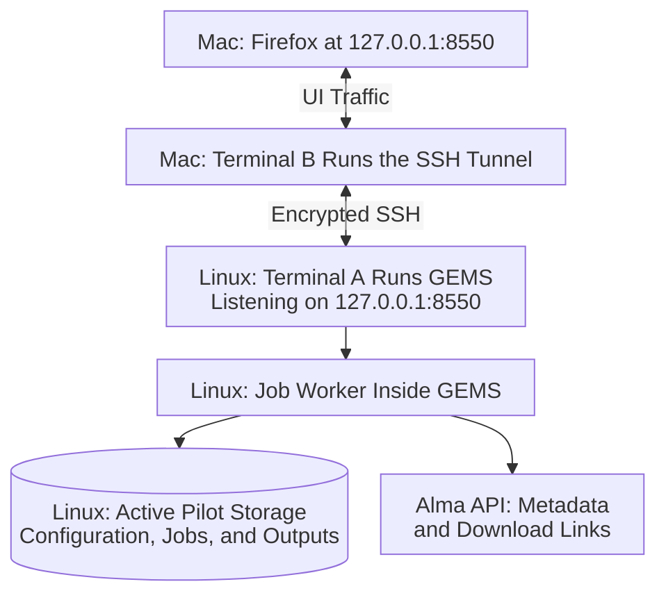
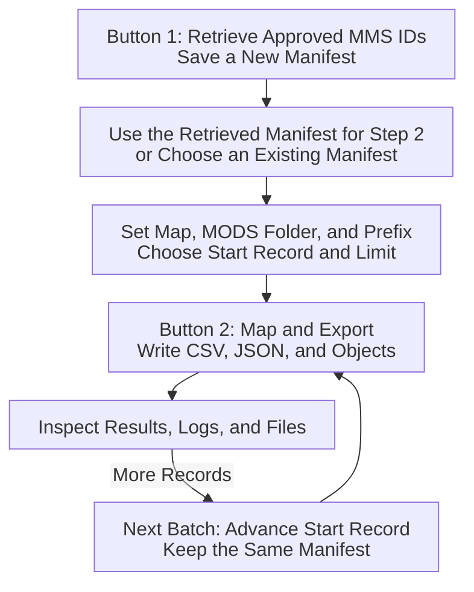
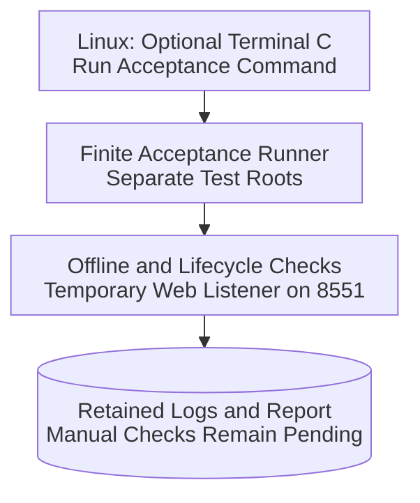

# GEMS on Linux: How the Pieces Fit Together

<style>
@media print {
  .mermaid-page {
    break-before: page;
    page-break-before: always;
    break-inside: avoid;
    page-break-inside: avoid;
  }
  .mermaid-page .mermaid,
  .mermaid-page pre {
    break-inside: avoid;
    page-break-inside: avoid;
  }
  .mermaid-page svg {
    display: block;
    width: auto !important;
    height: auto !important;
    max-width: 100% !important;
    max-height: 7.25in !important;
  }
}
</style>

## The Short Version

**GEMS runs on dg-landing. You operate it from Firefox on your Mac.**

For normal browser use, keep **two terminals** open:

1. A **Linux terminal** runs GEMS.
2. A **local Mac terminal** runs an SSH tunnel.

Then open Firefox on the Mac at <http://127.0.0.1:8550>.
An optional third terminal is just a Linux command prompt for inspecting files
or running tests. It is not another required service.

<div class="mermaid-page">

### Normal Browser Connection



</div>

The two `127.0.0.1` addresses mean different computers. Firefox reaches the
**Mac's** port 8550; the tunnel carries that traffic to **dg-landing's** port
8550. Without the tunnel, your Mac cannot reach this private Linux service.

## What Each Piece Does

| Piece | Where It Runs | Purpose | Keep It Running? |
| --- | --- | --- | --- |
| GEMS web process | dg-landing, Terminal A | Serves the UI and executes retrieval/export jobs | Yes, while using the UI or running its jobs |
| Job worker | Inside the GEMS process | Performs one job at a time; persists history and logs | Automatic; no separate launch |
| SSH tunnel | Mac, Terminal B | Connects the Mac browser to the private Linux listener | Yes, while using the browser |
| Firefox | Mac | Displays controls, submits jobs, and shows results | Closing a tab does not cancel a job |
| Inspection terminal | dg-landing, optional Terminal C | Runs `ls`, reads logs, or runs acceptance checks | Only when needed |
| Acceptance runner | dg-landing, optional Terminal C | Runs a finite set of isolated checks and writes a report | Only until the command finishes |
| Alma | External service contacted by dg-landing | Supplies records, metadata, and download links | No Alma process to launch yourself |

The current setup is a **foreground pilot**, not an automatically managed
Linux service. Do not also start a systemd GEMS service or a second normal
GEMS process against the same data root.

## Which Files Live Where

| Location on dg-landing | Role |
| --- | --- |
| `/home/sysadmin/GitHub/GEMS/` | Application source, documentation, tests, and `run.sh` |
| `/home/sysadmin/GitHub/GEMS/.venv/` | Linux Python interpreter and installed dependencies |
| `/home/sysadmin/gems-pilot/config/` | **Active pilot configuration**, including private `gems.env`, maps, and saved browser inputs |
| `/home/sysadmin/gems-pilot/data/` | **Active pilot data**, including job history, logs, manifests, and exported files |
| `/data/gems/` | Staged copy of the pilot; **not the active environment yet** |

For this phase, continue testing with `/home/sysadmin/gems-pilot/`.
Do not change the active roots to `/data/gems/` just because the copy exists.
The staged copy does not automatically receive new pilot changes.

Updating Git code does not move your data. Copying data does not update code,
rewrite embedded paths, or switch the running service.

## Start Normal Browser Use

These commands assume installation and storage initialization are already
complete. They do not install packages or initialize new storage.

### Terminal A: Start GEMS on Linux

Use a terminal connected to **dg-landing**: a regular SSH session or a VS Code
Remote - SSH terminal. If starting from a local Mac terminal, connect first:

```bash
ssh sysadmin@dg-landing
```

Then, on **Linux**:

```bash
cd ~/GitHub/GEMS
export GEMS_CONFIG_DIR="$HOME/gems-pilot/config"
export GEMS_DATA_DIR="$HOME/gems-pilot/data"
export GEMS_ENV_FILE="$GEMS_CONFIG_DIR/gems.env"
umask 077
./run.sh --web --env-file "$GEMS_ENV_FILE"
```

**Leave this terminal occupied by GEMS.** Do not expect a new shell prompt.
Startup errors and service errors appear here. Ctrl+C stops the service;
wait for shutdown before restarting or updating it.

### Terminal B: Start the Tunnel on the Mac

Open a **different, local Mac terminal**, not a Linux/Remote - SSH terminal:

```bash
ssh -N -o ExitOnForwardFailure=yes \
  -L 8550:127.0.0.1:8550 sysadmin@dg-landing
```

**Leave this terminal occupied by SSH.** No output and no shell prompt are
normal. The command only transports traffic; it does not start GEMS.
If it reports a port conflict, check whether your tunnel is already running
instead of starting duplicates.

### Firefox: Open the UI on the Mac

Open <http://127.0.0.1:8550>.

At the top of the GEMS page, confirm the displayed **Configuration** and
**Data** paths point to `/home/sysadmin/gems-pilot/config` and
`/home/sysadmin/gems-pilot/data`. Stop if they point to the wrong environment.

## Use the Web UI

### Step 1: Retrieve Metadata From Alma

In **Retrieve from Alma**:

1. For a small pilot, enter your approved comma-separated **MMS IDs**.
   Leave **Alma Set ID or Collection Title** blank. MMS IDs take precedence.
2. Set **Destination** to an existing Linux directory inside the active data
   root, such as `/home/sysadmin/gems-pilot/data/pilot`.
3. Click **1) Retrieve from Alma and Save JSON Manifest**.
4. Wait for state **succeeded** and message **Completed**. Check the result's
   record counts and warnings.
5. Click **Use this retrieved manifest for step 2**.

This saves a new timestamped run containing a manifest: a JSON snapshot of the
retrieved records and file descriptors. **It does not download the object files
yet.** Each click on button 1 creates a new run.

### Step 2: Map Metadata and Download Files

In **Map Manifest to CSV**:

1. Confirm **Prepared manifest** is the Linux path from step 1.
2. For the Grinnell mapping, enter
   `/home/sysadmin/gems-pilot/config/maps/alma-dc-to-grinnell.json` in **Field map**.
3. If testing legacy fallback, set **Legacy MODS folder** to
   `/home/sysadmin/gems-pilot/data/legacy-mods`.
4. Start with **Start record** `1`, **Record limit** `1`, and an
   **ObjectID prefix** such as `linux-pilot`.
5. Click **2) Map and Export Manifest to CSV**. Wait for **succeeded**.
6. Inspect the result paths and files before processing additional records.

Start/limit apply only to mapping, not retrieval. With the Grinnell template
map, map the next record using the **same manifest** and start `2`, limit `1`;
the CSV is merged with earlier batches. Do not retrieve again to add a batch.

If you already have a prepared manifest, you can enter its path and begin at
step 2 without retrieving again.

<div class="mermaid-page">

### Retrieval and Export Workflow



</div>

All UI paths are **Linux server paths**. Do not enter Mac paths or literal
`$HOME` expressions. The browser is not a local-file picker.

### Find Status, Logs, and Results

- **Job history:** select a retrieval/export job to see its persisted state,
  result JSON, and output paths.
- **Refresh job log:** loads the selected job's latest log text.
- **Cancel active job:** requests cancellation; the current operation may need
  to finish before the job stops. Partial files remain.
- **Saved `/jobs/<job-id>` URL:** returns to that job after refreshing the page.

Exports are saved beside the selected manifest:

```text
<run directory>/
    gems_....json              Retrieved manifest
    gems.log                   Run-level activity log
    collection_metadata.csv    Mapped metadata
    normalized_records.json    Structured mapped rows
    objects/                   Downloaded files
```

Full job logs are in
`/home/sysadmin/gems-pilot/data/jobs/<job-id>.log`; persisted state and inputs
are in the adjacent `<job-id>.json`. GEMS shows server paths, not automatically
downloaded Mac copies. Use the optional Linux terminal or a secure file copy to
inspect outputs.

Only one browser session controls the service at a time. A second tab is
read-only until the operator session releases control. Closing a browser tab
does not stop its running job, but stopping the Linux GEMS process does.

## Terminal C: Inspection and Acceptance Testing

Open another **Linux** terminal only when you need commands while Terminal A
is occupied. Shell exports belong to each terminal; a new terminal does not
inherit the exports you typed into another one.

The acceptance runner is **a separate, optional activity**, not a prerequisite
for every browser session:

```bash
cd ~/GitHub/GEMS
export GEMS_CONFIG_DIR="$HOME/gems-pilot/config"
export GEMS_DATA_DIR="$HOME/gems-pilot/data"
export GEMS_ENV_FILE="$GEMS_CONFIG_DIR/gems.env"
.venv/bin/python -m gems.pilot --env-file "$GEMS_ENV_FILE"
```

It runs finite checks in its own private evidence directory, briefly starts
its own web process on **8551**, stops that process, and prints the report
location. **No second tunnel or browser is needed for the automated runner.**
It leaves the normal GEMS process on 8550 alone. You may also run it while the
normal service is stopped.

<div class="mermaid-page">

### Optional Acceptance Runner



</div>

Do not point the normal UI at the runner's manifests until the runner finishes.
No live Alma retrieval occurs unless you explicitly supply `--mms-ids`.
An automated pass does not complete the manual acceptance checks.

Use the [Acceptance-Testing Guide](LINUX-PILOT-TEST.md) for exact commands,
evidence locations, expected outcomes, and manual checks. Use the
[Linux Installation Guide](INSTALL-LINUX.md) for installation, code updates,
storage initialization, and the eventual `/data` cutover.

## Stop, Restart, and Troubleshoot

| Situation | What to Do |
| --- | --- |
| Done with the browser, but a job is running | You can close the tab; keep Terminal A running |
| Done with all work | Wait for jobs or cancel them; Ctrl+C in Terminal A and wait for shutdown; Ctrl+C in Terminal B |
| Firefox cannot connect | Check Terminal A for errors and Terminal B for a running tunnel |
| Need to test Linux reachability | In Terminal C: `curl --noproxy '*' --fail http://127.0.0.1:8550/ -o /dev/null` |
| Linux curl works but Mac Firefox fails | Check/restart the Mac tunnel and confirm the browser URL |
| Linux curl fails | The Linux service is not ready/listening; inspect Terminal A |
| Another service owns this data root | Find the already-running service; do not bypass its lock |
| Fields/buttons are read-only | Check whether another browser tab owns control, a job is active, or storage has failed |
| Need to update application code/dependencies | Stop GEMS first, update the Linux checkout and web dependencies, then restart Terminal A; the tunnel can stay open |
| Service was stopped during a job | Restart with the same roots; unfinished persisted jobs become `interrupted`, not automatically resumed |

**Remember:** Terminal A runs the application, Terminal B connects the Mac to
it, Firefox operates it, and Terminal C is only a place to run extra commands.
